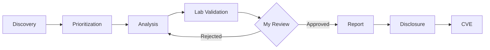

# Vulnerability Research Pipeline

My goal is to become a security researcher. While learning penetration testing, I built this AI powered pipeline to put what I was learning into practice on real software, and to find and disclose real vulnerabilities instead of only solving labs.

The pipeline automates most of the research workflow on open source software. It finds targets, ranks them, analyzes the code, and tests anything suspicious in a local lab. I review every finding before it gets reported.

## How it works

1. **Discovery** pulls WordPress plugins from the WordPress.org plugin directory, plus open source projects from GitHub.
2. **Prioritization** scores them on attack surface, active installs and maintenance activity.
3. **Analysis** combines static analysis, dynamic testing and LLM assisted code review to flag code that looks vulnerable.
4. **Lab validation** spins up the target in Docker and tries to reproduce the issue. If it can't be reproduced, it doesn't count.
5. **My review.** Nothing leaves the lab until I've gone through it.
6. **Reporting and disclosure.** The pipeline drafts the report, I submit it through Patchstack, and I follow it through to a fix and a CVE.

More detail on each stage in [docs/architecture.md](docs/architecture.md).

## Disclosed vulnerabilities

Ordered by severity. Only findings with an officially assigned CVE are listed.

| CVE | Product | Type | Severity | Details |
|---|---|---|---|---|
| [CVE-2026-121769](https://www.cve.org/CVERecord?id=CVE-2026-121769) | WP w3all phpBB (WordPress plugin) <= 3.1.9 | SQL Injection | High (8.5) | [Details](cves/CVE-2026-121769.md) |
| [CVE-2026-125434](https://www.cve.org/CVERecord?id=CVE-2026-125434) | RepairBuddy (WordPress plugin) <= 4.1235 | Broken Access Control | Medium (5.4) | [Details](cves/CVE-2026-125434.md) |
| [CVE-2026-125825](https://www.cve.org/CVERecord?id=CVE-2026-125825) | RepairBuddy (WordPress plugin) <= 4.1236 | Broken Access Control | Medium (5.3) | [Details](cves/CVE-2026-125825.md) |
| [CVE-2026-125438](https://www.cve.org/CVERecord?id=CVE-2026-125438) | RepairBuddy (WordPress plugin) <= 4.1235 | Broken Access Control | Medium (5.3) | [Details](cves/CVE-2026-125438.md) |

## Disclosure

All testing happens on local copies of software in my own lab, never on live systems. Maintainers get time to fix issues before anything goes public. Full policy in [DISCLOSURE.md](DISCLOSURE.md).

## Built with

* Python for the pipeline and its stage modules
* Claude (Anthropic LLM) for code review and false positive filtering
* Docker lab environments with WordPress, PHP and MySQL
* Patchstack for coordinated disclosure and CVE assignment

## About me

Nikita Mateo Volovik, MDR Analyst

[LinkedIn](https://www.linkedin.com/in/nikita-volovik) · [Patchstack profile](https://www.patchstack.com/database/researchers/c2b38a67-a14e-4b34-a8bd-ded27e35629f)
